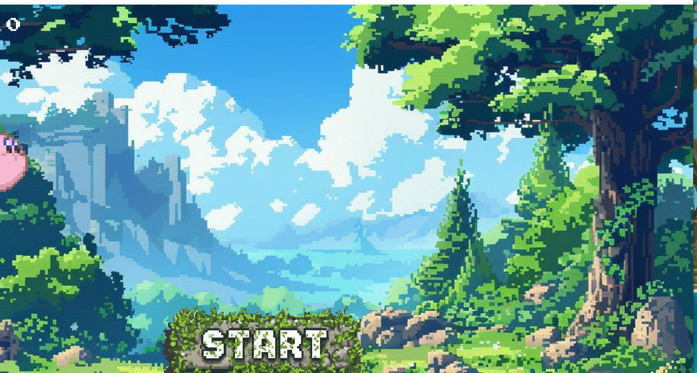

<div align="center">

# MyHunter

**A fast-paced arcade shooting game with animated targets and dynamic difficulty.**



</div>

---

## What it does

MyHunter is a graphical arcade game built with CSFML that challenges players to shoot at rapidly
moving Kirby characters before they escape the screen, in a 60-second session. It features
multiple movement patterns, animated sprites, sound effects, and a scoring system with
progressively increasing difficulty.

## Features

- **Dynamic target spawning** — targets spawn in waves at increasing speeds, with wave/ellipse/zigzag movement patterns
- **Hit detection & scoring** — precise click detection, real-time hit/miss/escape tracking, 3-miss game over
- **Progressive difficulty** — speed increases as the score climbs
- **Audio & visuals** — animated sprites, custom crosshair, ammo counter, background music and sound effects

## Installation / Usage

```bash
make          # Build
./my_hunter   # Run
```

Requires GCC (C99) and the CSFML libraries (graphics, system, window, audio). Controls, scoring
rules, game states, and full architecture: **[docs/REFERENCE.md](docs/REFERENCE.md)**.

## Tech stack

C (C99), CSFML, Make

## License

School project — see [LICENSE](LICENSE)
